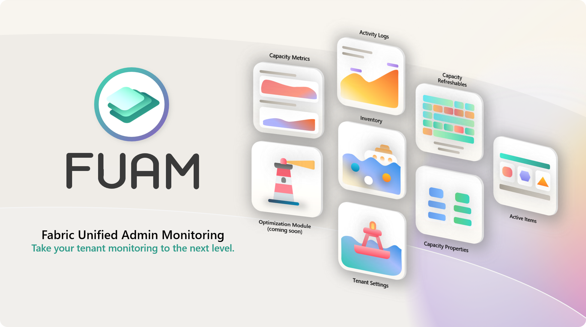
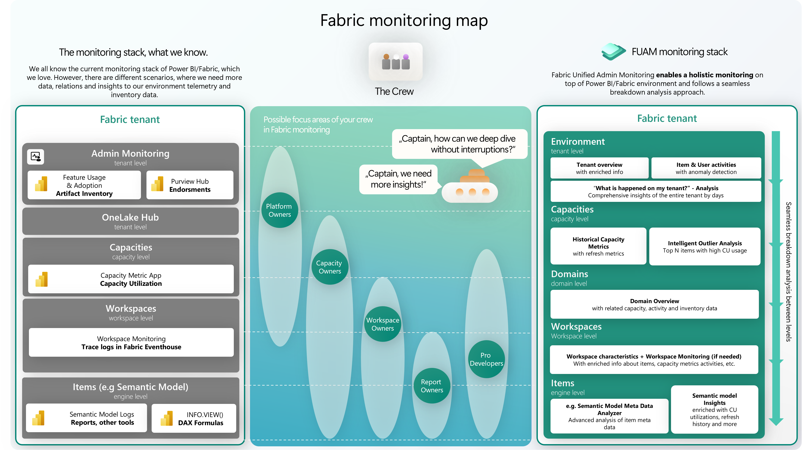
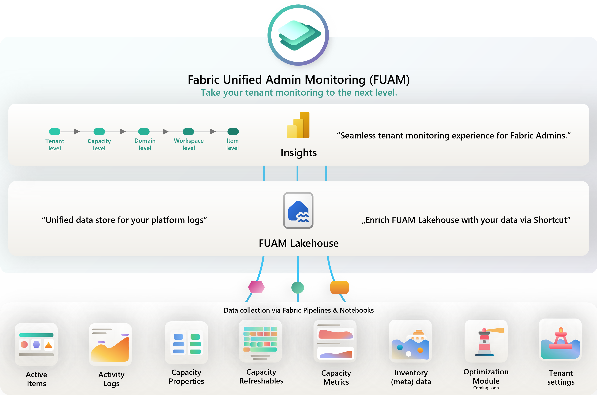
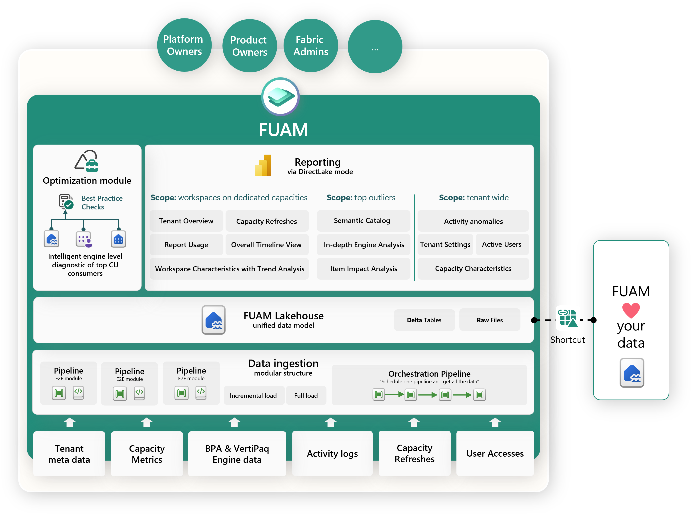

# Fabric Unified Admin Monitoring (FOS)

**Solution accelerator for Fabric platform admin monitoring**

[Want to get a brief introduction on FOS? - Watch the video](https://youtu.be/CmHMOsQcMGI)

> [!IMPORTANT]  
> FOS will support the Capacity Utilization Events mode in the future. This features takes Fabric monitoring to the next level by providing near-real time CU consumption.

> [!CAUTION]  
> The FOS solution accelerator is not an official Microsoft product! It is a solution accelerator, which can help you implement a monitoring solution within Fabric. As such there is no offical support available and there is a risk that things might break. E.g. the extraction of Capacity Metrics data. This is based on the Capacity Metrics App and elements of that App could change without notice and impact FOS.

## Introduction

Fabric Unified Admin Monitoring (short: FOS) is a solution to enable holistic monitoring on top of Microsoft Fabric. Today, monitoring for Fabric can be done through different reports, apps, and tools.

FOS aims to provide a more holistic view on top of the various information that can be extracted from Fabric, allowing its users to analyze at a very high level, but also to deep dive into specific items for more fine-grained data analysis.

FOS is completely built with Fabric capabilities, with Pipelines and Notebooks as the main tools to extract and transform data. All the data is stored in its raw format, but also in Delta Parquet, enabling the user to directly use it through Power BI Direct Lake or the Lakehouse SQL Endpoint via SQL. FOS comes with a set of standard reports enabling a quick overview of the data, but it's intended to give users all the tools to customize or build their own reports on top of the data model. Through the openness of Fabric, it's also possible to combine it with your own data, enabling you to do the analysis you wish.

## FOS Content

FOS extracts the following data from the tenant:

- Tenant Settings
- Delegated Tenant Settings
- Activities
- Workspaces
- Capacities
- Capacity Metrics
- Tenant meta data (Scanner API)
- Capacity Refreshables
- Git Connections
- Engine level insights (coming soon in optimization module)

### Architecture

The architecture of FOS is built on Fabric items like Pipelines, Notebooks, Lakehouses, Semantic Models, and Power BI reports. We have built the component in a modular structure, which helps you extend FOS with your own modules. This architectural design also makes the solution easier to maintain.

The data ingestion logic is orchestrated and parameterizable, which allows us to use the main orchestration pipeline for initial and incremental data loads. FOS Lakehouse is one of the core components in the architecture. All the data is transformed and persisted in a way that opens up amazing capabilities for analyzing the collected data in a semantic model with DirectLake mode.

### Benefits
- Modular building blocks
- One-source-of-truth approach
- End-to-end report experience
- Intelligent optimization module (coming soon)
- Long term CU utilization analysis
- Bring your own data & enrich FOS with your data

## Setup

Are you ready to try FOS out? We have prepared two step-by-step guides to help you deploy FOS in your workspace on your tenant:

#### [Click here to **deploy** FOS](/monitoring/fabric-unified-admin-monitoring/how-to/How_to_deploy_FOS.md)

#### [Click here to **update** FOS](/monitoring/fabric-unified-admin-monitoring/how-to/How_to_update_FOS.md)

## Changelog

- **FOS [Release 2026.2.1 (latest)](/monitoring/fabric-unified-admin-monitoring/changelog/FOS_Changelog.md)**
- **FOS [Release 2026.1.1](/monitoring/fabric-unified-admin-monitoring/changelog/FOS_Changelog.md)**
- **FOS [Release 2025.9.1](/monitoring/fabric-unified-admin-monitoring/changelog/FOS_Changelog.md)**

## Support
The FOS solution accelerator template **is not an official Microsoft service**.

**Ideas/Suggestions:** Submit your ideas and suggestions as an issue in this repository.

**Bug Reports:** We maintain a backlog on the project issues page. Let us know if you run into any problems or share your suggestions by adding an entry into the issues section.

**Important:** Please do not open a support ticket in case of an issue regarding the templates. In case of any questions or issues regarding the templates, please create an issue in this repository.

----------------

## Other helpful resources

##### Built-in Fabric monitoring features
- [Microsoft Fabric Capacity Metrics app ](https://learn.microsoft.com/en-us/fabric/enterprise/metrics-app)
- [What is the admin monitoring workspace? (preview)](https://learn.microsoft.com/en-us/fabric/admin/monitoring-workspace)
- [Microsoft Fabric Chargeback app (preview)](https://learn.microsoft.com/en-us/fabric/enterprise/chargeback-app)

##### FOS related videos
- [Video - FOS in Guy in a Cube](https://www.youtube.com/watch?v=G_-N2VMO8C0&themeRefresh=1)
- [Video - Brief introduction to FOS](https://youtu.be/CmHMOsQcMGI)

##### Other FOS articles
- [Overview - FOS](/monitoring/fabric-unified-admin-monitoring/README.md)
- [Documentation - FOS's Authorization & Authentication](/monitoring/fabric-unified-admin-monitoring/media/documentation/FOS_Authorization.md)
- [Documentation - FOS Architecture](/monitoring/fabric-unified-admin-monitoring/media/documentation/FOS_Architecture.md)
- [Documentation - FOS Lakehouse table lineage](/monitoring/fabric-unified-admin-monitoring/media/documentation/FOS_Documentation_Lakehouse_table_lineage.pdf)
- [Documentation - FOS Engine level analyzer reports](/monitoring/fabric-unified-admin-monitoring/media/documentation/FOS_Engine_Level_Analyzer_Reports.md)
- [Documentation - FOS Core Report](/monitoring/fabric-unified-admin-monitoring/media/documentation/FOS_Core_Report.md)
- [Documentation - FOS Technical Deep Dive](/monitoring/fabric-unified-admin-monitoring/media/documentation/FOS_Technical_Deep_Dive.md)
- [Development - Add a FOS module](how-to/How_to_add_FOS_Module.md)

##### Some other Fabric Toolbox assets
- [Module - Fabric Cost Analysis](docs/modules/cost-analysis/README.md)
- [Overview - Fabric Spark Monitoring](/monitoring/fabric-spark-monitoring/README.md)
- [Overview - Fabric Workspace Monitoring report templates](/monitoring/workspace-monitoring-dashboards/README.md)
- [Overview - Semantic Model MCP Server](https://github.com/microsoft/fabric-toolbox/tree/main/tools/SemanticModelMCPServer)
- [Overview - Semantic Model Audit tool](/tools/SemanticModelAudit/README.md)

##### Semantic Link & Semantic Link Lab
- [What is semantic link?](https://learn.microsoft.com/en-us/fabric/data-science/semantic-link-overview)
- [Overview - Semantic Link Labs](https://github.com/microsoft/semantic-link-labs/blob/main/README.md)

----------------
